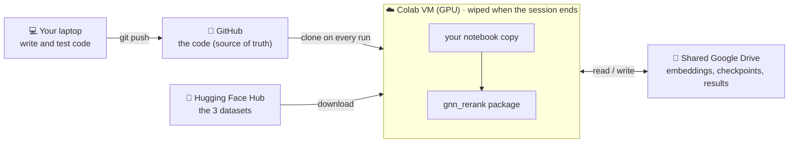
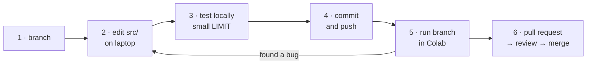

# CS 682 Final Project: GNN vs. cross-encoder reranking for multi-hop RAG

We compare ways of **reranking retrieved passages** for multi-hop question answering. A dense
retriever (FAISS) fetches 20 candidate passages per question. Then each method picks the best 5:

| | Method | Idea |
|---|---|---|
| E1 | Cosine similarity | Baseline: keep FAISS's own top 5 |
| E2 | Cross-encoder | A transformer scores each (question, passage) pair, fine-tuned on our data |
| E3 | GNN | Treat the 20 passages as a graph (edges = similar passages) and score them with a GAT |
| E4 | Hybrid | GNN that also gets the cross-encoder's scores as node features |

We evaluate retrieval quality (Recall@5, MRR, nDCG) and end-to-end answer quality (EM/F1 from a
frozen LLM) on **HotpotQA**, **2WikiMultiHopQA** and **MuSiQue**.

**Contents:** [How the setup works](#how-the-setup-works) ·
[One-time setup](#one-time-setup) ·
[Workflow 1: running experiments](#workflow-1-running-experiments-in-colab) ·
[Workflow 2: changing the code](#workflow-2-changing-the-code) ·
[Testing](#testing-your-changes) ·
[Saving results](#saving-results-and-artifacts) ·
[The data](#the-data) ·
[Mac or Colab?](#mac-or-colab) ·
[Troubleshooting](#troubleshooting) ·
[Git cheat sheet](#git-cheat-sheet)

---

## How the setup works

Four places hold parts of the project. Each one has a single job:



| Place | What lives there | Lasts? | Who edits it |
|---|---|---|---|
| **GitHub** ([repo](https://github.com/andrew-erlanger/umass-fall-2026-682-final-project)) | All code: the `gnn_rerank` package, the starter notebook | ✅ permanent | Everyone, through pull requests |
| **Your laptop** | Your clone of the repo, where you write code | ✅ | You |
| **Colab VM** | A GPU machine that clones the repo, installs it and runs your notebook | ❌ **erased when the session ends** (including idle timeouts) | Nobody: treat it as disposable |
| **Shared Drive** ([folder](https://drive.google.com/drive/folders/1GjBXAOSqHJspuhrfvnRj1VXr4uEwXP12)) | Big outputs: embeddings, model checkpoints, result tables | ✅ | Everyone |
| **Your own Drive** | Your personal copy of the notebook (*Colab Notebooks* folder) | ✅ | You |
| **Hugging Face Hub** | The raw datasets; we only download from it | ✅ | Nobody |

Two rules follow from this:

1. **Code moves in one direction: laptop → GitHub → Colab.** Write code on your laptop, push it, and
   Colab pulls it. Don't edit code on the Colab VM: the clone cell resets the VM's copy every time it
   runs, and the VM is erased anyway.
2. **Code goes in git; data and models go in Drive.** Git is for small text files. Anything large or
   generated (embeddings, checkpoints, `.npy` files) goes in the shared Drive folder. `.gitignore`
   blocks those files so they can't be committed by accident.

### What's in the repo

```
src/gnn_rerank/          the Python package: all reusable code goes here
  data.py                dataset loaders (all three datasets → one common format)
notebooks/
  starter.ipynb          Colab entry point: sets up the VM, then you add experiment cells
pyproject.toml           package metadata and dependencies (managed with uv)
uv.lock                  exact dependency versions for local installs (commit it, don't edit it)
.gitignore               keeps data, checkpoints and caches out of git
.gitattributes           tells git to strip notebook outputs on commit (nbstripout)
```

Why a package rather than notebooks? Code in `src/gnn_rerank/` can be imported by every notebook,
reviewed in pull requests and diffed line by line. Code inside notebooks can't, at least not easily.
Notebooks should be thin: import from the package, call functions, look at results.

---

## One-time setup

### On GitHub

1. Accept the collaborator invite to the repo (check your email or github.com/notifications).
2. Create a **personal access token** so Colab can clone the private repo:
   [github.com/settings/personal-access-tokens/new](https://github.com/settings/personal-access-tokens/new)
   - *Resource owner:* `andrew-erlanger` · *Repository access:* only this repo ·
     *Permissions → Contents:* **Read-only**
   - If GitHub won't let you pick the repo (fine-grained tokens on someone else's repo can be
     restricted), create a [classic token](https://github.com/settings/tokens/new) with the `repo`
     scope instead.
   - Copy the token now. GitHub only shows it once.

### In Google Drive

3. Open the [shared folder](https://drive.google.com/drive/folders/1GjBXAOSqHJspuhrfvnRj1VXr4uEwXP12),
   click its name → **Organize → Add shortcut** → **My Drive**. **Don't rename the shortcut**: the
   notebook looks for `MyDrive/umass-fall-2026-682-final-project`.

### In Colab

4. Open the starter notebook:
   **[notebooks/starter.ipynb in Colab](https://colab.research.google.com/github/andrew-erlanger/umass-fall-2026-682-final-project/blob/master/notebooks/starter.ipynb)**.
   The first time, Colab asks you to **Authorize with GitHub**. Accept, and tick **Include private
   repos**. If you see *"Colab could not open a new browser window"*, allow pop-ups for
   colab.research.google.com and click Retry.
5. Open the 🔑 **Secrets** panel (left sidebar) → **Add new secret**:
   - Name `GITHUB_TOKEN`, value = your token, **Notebook access** toggled on.
   - Optional: `HF_TOKEN` with a [Hugging Face token](https://huggingface.co/settings/tokens). Our
     datasets are public, but a token gives faster downloads and gets rid of the warning.

   Secrets belong to your Google account, not to a notebook, so you only do this once.
6. **File → Save a copy in Drive.** This is *your* notebook from now on (it lands in
   *My Drive/Colab Notebooks*). Work in your copy, never in the original.
7. In your copy: **Runtime → Run all**. Approve the Drive prompt with the Google account that has the
   shared folder. If everything works, the last cell prints **✅ Environment OK** and writes
   `smoke_test.txt` to the shared folder.

### On your laptop (to write code)

8. Install [uv](https://docs.astral.sh/uv/getting-started/installation/), the Python
   project manager we use instead of pip/conda/venv. Then:

   ```sh
   git clone https://github.com/andrew-erlanger/umass-fall-2026-682-final-project.git
   cd umass-fall-2026-682-final-project
   uv sync                       # creates .venv/ with the right Python and all dependencies
   uv run nbstripout --install   # once per clone: strips notebook outputs on commit
   ```

   The repo is private, so `git clone` needs to know who you are. The easiest way is to install the
   [GitHub CLI](https://cli.github.com/) and run `gh auth login` once before cloning. (If you already
   use SSH keys with GitHub, clone `git@github.com:andrew-erlanger/umass-fall-2026-682-final-project.git`
   instead.)

   `uv sync` installs the exact versions in `uv.lock`, so everyone's laptop gets the same environment.
   To run anything inside that environment, prefix it with `uv run` (`uv run python script.py`), or
   point VS Code/Cursor at `.venv` as the interpreter and notebook kernel.

   Check that it worked:

   ```sh
   uv run python -c "from gnn_rerank import data; print(data.load('musique', limit=5))"
   ```

---

## Workflow 1: running experiments in Colab

Each session, open **your copy** of the notebook and **Runtime → Run all**. The setup cells:

| Cell | What it does | Why |
|---|---|---|
| 1. Confirm the GPU | Prints the GPU name, warns if it isn't an A100 | Catch a wrong runtime type before wasting time |
| 2. Clone the repo | Clones (or updates) `/content/repo` to the latest commit of `BRANCH` | Always runs the latest pushed code |
| 3. Install the package | `pip install -e` the repo and turns on autoreload | So `from gnn_rerank import ...` works and picks up code changes |
| 4. Connect Drive | Mounts Drive, sets `DRIVE_DIR`, `EMB_DIR`, `CKPT_DIR` | Somewhere to save results that outlives the VM |
| 5. Load the datasets | Loads all three datasets into `datasets[...]` | `LIMIT = 64` loads a small sample; set `LIMIT = None` for the full data |
| 6. Smoke test | Embeds a few passages, builds graphs, trains a tiny GNN, writes to Drive | Proves the whole stack works on this VM |

Add your experiment cells **below** these. Things to know:

- **`LIMIT`** controls how much data loads. Use a small number (64–500) while you're getting code to
  work, which takes seconds, and `None` for real runs. The full data is about 1 GB and takes a few
  minutes to download each session.
- **The VM is temporary.** Anything saved under `/content` disappears when the session ends. Save
  results to `DRIVE_DIR` (see [Saving results](#saving-results-and-artifacts)).
- **Your notebook copy doesn't update itself.** If the starter notebook in the repo gets new setup
  cells, copy them across or start a fresh copy. The *package code* always updates, because cell 2
  pulls it on every run.
- **Runtime type:** *Runtime → Change runtime type → A100* for heavy jobs. If no A100 is free, Colab
  falls back to a T4. That's fine for small tests, but too slow for training big models.
- **Close the session when you're done** (*Runtime → Disconnect and delete runtime*). Idle VMs still
  use up GPU quota.

---

## Workflow 2: changing the code

Here's the loop for adding or changing code, for example a new reranker, a metric or a fix:



**1. Start a branch** from an up-to-date `master`. A branch is your private line of work; `master`
stays clean and runnable for everyone else.

```sh
git switch master && git pull
git switch -c luke/cross-encoder        # convention: <your-name>/<topic>
```

**2. Edit code in `src/gnn_rerank/`** on your laptop, in your editor. Add a new module per concern
(`retrieval.py`, `rerank_ce.py`, `graph.py`, `metrics.py`, …) rather than one giant file.

**3. Test it locally on a small sample** (see [Testing](#testing-your-changes)).

**4. Commit and push.** A commit is a saved snapshot with a message; pushing uploads it to GitHub.

```sh
git status                              # see what changed
git add src/gnn_rerank/rerank_ce.py     # stage the files you mean to commit
git commit -m "Add cross-encoder reranker"
git push -u origin luke/cross-encoder   # first push of a branch; afterwards just `git push`
```

**5. Run your branch in Colab.** In your notebook's clone cell set `BRANCH = 'luke/cross-encoder'`
and rerun that cell. It pulls your latest push. Thanks to autoreload, edits to existing modules
take effect right away; just rerun the cells that use them. Found a bug? Fix it on your laptop, push,
rerun the clone cell. Each round trip takes seconds.

**6. Open a pull request (PR)** on GitHub. After your first push, GitHub shows a *Compare & pull
request* button. Describe what the change does and how you tested it. A teammate reviews it and
merges it into `master`. Then everyone gets it on their next run.

Ground rules:

- **Don't push directly to `master`.** Always use a branch and a PR, even for small changes. That
  way `master` always works for everybody's experiments.
- **Keep PRs small and focused.** One method or one fix per PR is easy to review. A week of mixed
  changes is not.
- **Pull `master` often** (`git switch master && git pull`, then `git switch your-branch && git merge
  master`) so your branch doesn't drift far from everyone else's.

### Prototyping in a notebook first

It's fine to work out an idea in notebook cells. Once a function works and you want to keep it, **move
it into a module in `src/gnn_rerank/` on your laptop** and replace the cell with an import. Signs it's
time: you've copied the cell into a second notebook, or someone else needs it.

### Sharing a notebook

Your notebook copy lives in your Drive and can be shared like any Google Doc, which is fine for
showing someone results. To put an analysis notebook in the repo, download it (*File → Download →
.ipynb*), move it into `notebooks/` on your laptop, and commit it on a branch like any other file.
nbstripout removes cell outputs at commit time, so notebooks don't cause merge conflicts. (Avoid
Colab's *File → Save a copy in GitHub*: it commits straight to the repo *with* outputs.)

### Adding a dependency

```sh
uv add faiss-cpu       # updates pyproject.toml and uv.lock, installs it locally
```

Commit both files. In Colab, rerun the install cell (cell 3). If the new package fails to import,
*Runtime → Restart session* and run all again. **Never pin `torch`**: Colab ships its own CUDA build,
and replacing it breaks the GPU setup.

---

## Testing your changes

Three levels, from fastest to slowest:

**1. Locally on a small sample: seconds, no GPU needed.** Every loader takes `limit=N` and streams
just the first N questions instead of downloading the full dataset:

```python
# scratch.py, or a cell in a local notebook using the .venv kernel
from gnn_rerank import data
ds = data.split_train_val(data.load("hotpotqa", limit=50))
# ...call your new code on ds["train"] / ds["dev"]...
```

```sh
uv run python scratch.py
```

Write device-agnostic code so the same thing runs on a Mac, a CPU and Colab:

```python
import torch
DEVICE = "cuda" if torch.cuda.is_available() else "mps" if torch.backends.mps.is_available() else "cpu"
```

Use this level for most development: shapes, logic, the metric on a toy example, and whether the loss
goes down at all.

**2. In Colab on a small sample: about 2 minutes.** Run your branch with `LIMIT = 64` (the default)
to confirm it works on the GPU VM with Colab's library versions. This is the check that matters
before opening a PR.

**3. The real run.** Set `LIMIT = None`, use an A100, and save the outputs to Drive.

Before asking for review, make sure the starter notebook still reaches **✅ Environment OK** on your
branch.

---

## Saving results and artifacts

Anything worth keeping goes in the shared Drive folder. The notebook defines these paths:

| Variable | Path | Put here |
|---|---|---|
| `DRIVE_DIR` | `MyDrive/umass-fall-2026-682-final-project/` | Root of the shared folder |
| `EMB_DIR` | `…/embeddings/` | Passage/question embeddings, FAISS indexes |
| `CKPT_DIR` | `…/checkpoints/` | Trained model weights |

Conventions, so we can find each other's work:

- **Name files by dataset, model and split:** `embeddings/musique/all-MiniLM-L6-v2_dev.npy`,
  `checkpoints/cross-encoder/hotpotqa_minilm_epoch2/`.
- **Save results as files, not just notebook output:** write metric tables to
  `results/<method>_<dataset>.csv` (create the folder when you need it). Notebook output is
  stripped on commit and lost with the VM.
- **Don't overwrite someone else's files.** Add your name or a date if in doubt.
- **Expensive steps should check Drive first**, e.g. "if the embeddings file exists, load it,
  otherwise compute and save it". Then a new session doesn't redo 15 minutes of work.

---

## The data

All three datasets come from the Hugging Face Hub, are public (no token needed) and are converted by
`gnn_rerank.data` into **one shared format**, so downstream code never needs to care which dataset it
is reading:

```python
from gnn_rerank import data
ds = data.split_train_val(data.load("musique"))      # or "hotpotqa", "2wiki"
ds["train"], ds["val"], ds["dev"]                     # dev = our test set
row = ds["dev"][0]
```

```python
{
    "question_id": "2hop__460946_294723",
    "question": "Who is the spouse of the Green performer?",
    "answer": "Miquette Giraudy",
    "answer_aliases": [],                    # alternative correct answers (MuSiQue only)
    "passages": [                            # the candidate paragraphs for this question
        {"doc_id": "2hop__460946_294723_0",  # unique across the dataset
         "title": "Grant's First Stand",
         "text": "Grant's First Stand is the debut album by ...",
         "is_supporting": False},            # True = needed to answer (the gold label)
        ...
    ],
    "gold_support_ids": ["2hop__460946_294723_5", "2hop__460946_294723_10"],
    "dataset": "musique",
}
```

| Dataset | HF source | Train / dev questions | Passages / question | Gold / question |
|---|---|---|---|---|
| HotpotQA (distractor) | `hotpotqa/hotpot_qa` | 90,447 / 7,405 | 10 | 2 |
| 2WikiMultiHopQA | `framolfese/2WikiMultihopQA` | 167,454 / 12,576 | 10 | 2 or 4 |
| MuSiQue-Ans | `bdsaglam/musique` | 19,938 / 2,417 | 20 | 2–4 |

- The official **test** sets have no labels, so **dev is our test set**. Never train or tune on it.
- `split_train_val()` holds out 10% of train as **val** for tuning (fixed seed 682, so everyone gets
  the same split).
- About 1.03M unique passages across all three datasets.

---

## Mac or Colab?

Measured on an M4 Pro MacBook. The A100 figures are estimates.

| Task | MacBook (Apple GPU) | A100 |
|---|---|---|
| Embed all ~1M passages (MiniLM) | ~15 min | ~1–2 min |
| FAISS search | seconds | seconds |
| GNN training (one epoch) | under a minute (CPU is fine) | same |
| Small cross-encoder (MiniLM), one training epoch | ~9–28 h | ~20–30 min |
| Large cross-encoder (BGE-reranker-v2-m3), one training epoch | ~10 days ❌ | ~3–4 h |
| 8B LLM answers on all dev sets | ~2–3 days ❌ | ~1 h |

In short: **develop and debug anywhere on small samples. Run big cross-encoder training and LLM
evaluation on the A100.** GNN work and embeddings are fine on a laptop.

---

## Troubleshooting

| Symptom | Cause / fix |
|---|---|
| Colab: *"Notebook not found"* opening the starter link | Colab isn't authorized for private repos. Click *Authorize with GitHub* and tick *Include private repos* |
| Colab: *"could not open a new browser window"* | Pop-ups are blocked. Allow pop-ups for colab.research.google.com, click *Retry* |
| Clone cell: `SecretNotFoundError` | No secret named exactly `GITHUB_TOKEN`, or *Notebook access* is off in the Secrets panel |
| Clone cell: `Repository not found` / `Authentication failed` | The token can't see the repo. Check you accepted the invite, then make a classic token with `repo` scope |
| Drive cell: `credential propagation was unsuccessful` | The sign-in pop-up was blocked or the wrong account was picked. Rerun the cell and choose the account that has the shared folder |
| Drive cell: `... not found: add a shortcut` | The shortcut to the shared folder is missing from *My Drive*, or was renamed |
| GPU cell: *"Not an A100"* / "selected GPU type was not available" | No A100 free right now. Fine for testing; wait or retry later for real runs |
| Install cell: red pip line about `cudf` and `pyarrow` | Harmless: we don't use cudf |
| My code change isn't showing up in Colab | Did you push? Is `BRANCH` right? Rerun the clone cell, then the cells that use the code. Still stale: *Runtime → Restart session*, run all |
| `ModuleNotFoundError` for a newly added dependency | Rerun the install cell; if it persists, *Runtime → Restart session* |
| `git push` rejected (*"fetch first"*) | Someone pushed to your branch, or you're on `master`. `git pull` then push again; never force-push `master` |

---

## Git cheat sheet

| I want to… | Command |
|---|---|
| See what I've changed | `git status`, then `git diff` |
| Get the latest `master` | `git switch master && git pull` |
| Start new work | `git switch -c <name>/<topic>` |
| Save a snapshot | `git add <files>` then `git commit -m "What and why"` |
| Upload my branch | `git push` (first time: `git push -u origin <branch>`) |
| Bring `master`'s new changes into my branch | `git switch <branch> && git merge master` |
| Throw away my uncommitted edits to a file | `git restore <file>` |
| See recent history | `git log --oneline -10` |

Stuck with git? Ask in the group chat before trying anything with `--force`.
