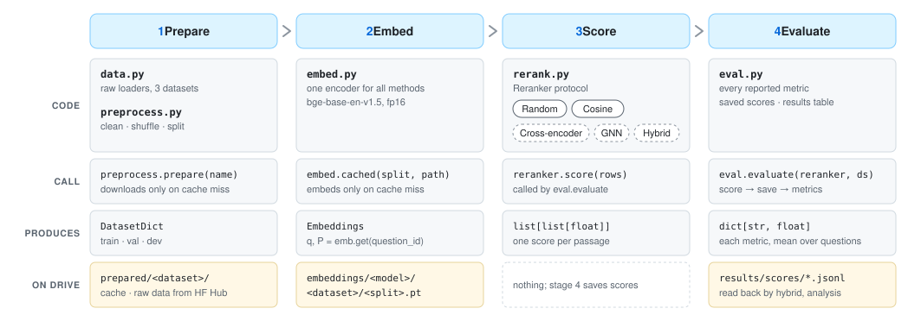
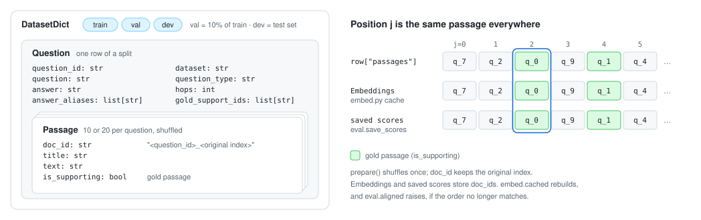
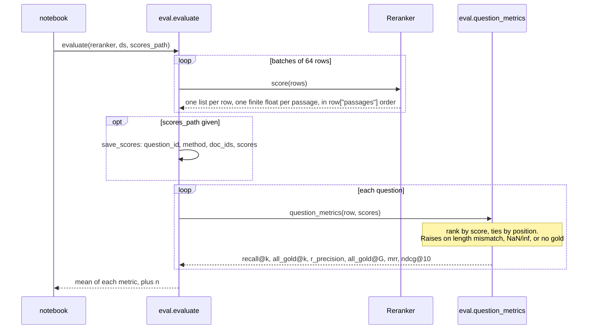

# Architecture

Signatures and details live in the docstrings.

## System map



Dashed chips are planned methods. Stage 4 runs stage 3 itself (see [API](#api)).

| Cache on Drive | Reused only if | Otherwise |
| --- | --- | --- |
| `prepared/<dataset>[_limitN]/` | `version`, `min_gold`, `shuffle`, `seed` match its `report.json` | rebuilt |
| `embeddings/<model>/<dataset>/<split>.pt` | same model, questions and passage order | recomputed |
| `results/scores/*.jsonl` | same questions and passage order | `eval.aligned` raises |

Bump `preprocess.VERSION` whenever the contents of a prepared row change.

## Data model



| Field | Values |
| --- | --- |
| `dataset` | `hotpotqa` · `2wiki` · `musique` |
| `question_type` | hotpotqa: `bridge` / `comparison` · 2wiki: its `type` field · musique: `2hop` / `3hop` / `4hop` |
| `hops` | musique: from its id · others: number of gold passages |
| passages | hotpotqa 10 · 2wiki 10 · musique 20, minus empty and duplicate passages |

## API



Reusing saved scores without the model (hybrid, error analysis):

```python
scores = eval.aligned(ds, eval.load_scores(path))
eval.evaluate_scores(ds, scores)                        # overall
eval.evaluate_by(ds, scores, key="question_type")       # per type or per "hops"
```

| Metric | Per question | Note |
| --- | --- | --- |
| `recall@k` | gold in top k / G | k ∈ {1, 2, 5, 10} |
| `all_gold@k` | 1 if all G gold in top k | |
| `r_precision` | gold in top G / G | |
| `all_gold@G` | 1 if top G are exactly the gold | headline: fair across 2–4 hops |
| `mrr` | 1 / rank of first gold | |
| `ndcg@10` | binary relevance | |

G = that question's number of gold passages. Tune on `val`, report on `dev`.
