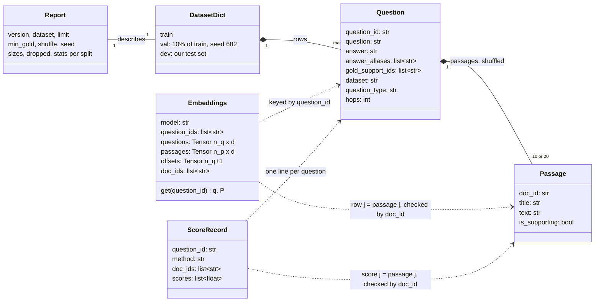
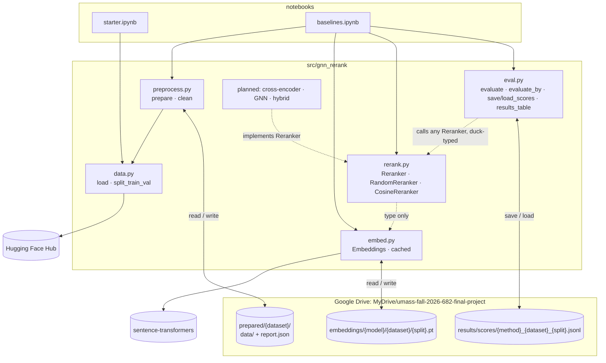
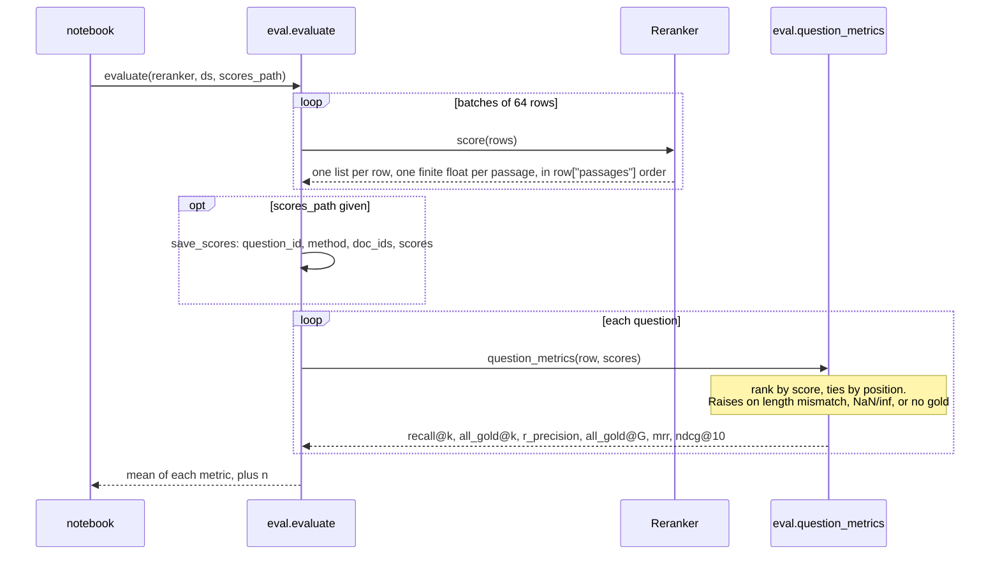

# Architecture

Diagrams of the data model, the modules and the API. Signatures and details live in the docstrings.

## 1. Data ontology

| Field | Values |
| --- | --- |
| `doc_id` | `<question_id>_<original index>`. It survives the shuffle, so it identifies a passage everywhere |
| `dataset` | `hotpotqa` · `2wiki` · `musique` |
| `question_type` | hotpotqa: `bridge` / `comparison` · 2wiki: its `type` field · musique: `2hop` / `3hop` / `4hop` |
| `hops` | musique: from the id · others: number of gold passages |
| passages per question | hotpotqa 10 · 2wiki 10 · musique 20, minus empty and duplicate passages |

## 2. Module structure

Solid arrows are imports. Dashed arrows are interface relationships.

### Caches and what invalidates them

| Cache | Written by | Reused only if | On mismatch |
| --- | --- | --- | --- |
| `prepared/<dataset>[_limitN]/` | `preprocess.prepare` | `version`, `min_gold`, `shuffle` and `seed` all match `report.json` | rebuild |
| `embeddings/<model>/<dataset>/<split>.pt` | `embed.cached` | same model, question ids **and passage `doc_id` order** | recompute |
| `results/scores/*.jsonl` | `eval.save_scores` | `eval.aligned` finds every question **with the same passage order** | raise |

Bump `preprocess.VERSION` whenever a prepared row's contents change.

## 3. API

### Pipeline

```mermaid
flowchart LR
    hub[(HF Hub)] -->|"preprocess.prepare(name, limit, cache_dir)"| ds["DatasetDict<br/>train · val · dev"]
    ds -->|"embed.cached(ds[split], path)"| emb[Embeddings]
    emb -->|"CosineReranker(emb)"| rr{{"Reranker<br/>.name<br/>.score(rows) → list[list[float]]"}}
    yours[your method] -.->|implements| rr
    rr -->|"eval.evaluate(rr, ds[split], scores_path=…)"| metrics["metrics<br/>dict[str, float] + n"]
    rr -->|"scores_path"| file[("scores .jsonl")]
    file -->|"eval.load_scores → eval.aligned(ds, saved)"| scores["list[list[float]]"]
    scores -->|"eval.evaluate_scores(rows, scores)"| metrics
    scores -->|"eval.evaluate_by(rows, scores, key)"| groups["dict[group, metrics]"]
    metrics -->|"eval.results_table({(method, dataset): metrics})"| table[markdown table]
```

### `eval.evaluate` and the `Reranker` contract

| Metric | Per question | Use |
| --- | --- | --- |
| `recall@k` | gold in top k / G | k ∈ {1, 2, 5, 10} |
| `all_gold@k` | 1 if all G gold in top k | multi-hop answerability |
| `r_precision` | gold in top G / G | |
| `all_gold@G` | 1 if top G are exactly the gold | headline metric, fair across 2–4 hops |
| `mrr` | 1 / rank of first gold | |
| `ndcg@10` | binary relevance | |

G = that question's number of gold passages. Tune on `val`, report on `dev`.
