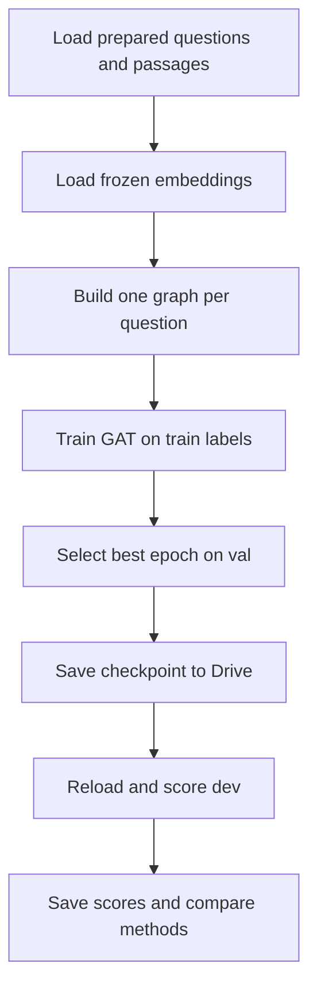

# GNN passage reranking

The GNN assigns a relevance score to each candidate passage. Related passages
can exchange information before scoring. It does not generate answers.

```text
Question: Where was the author of Book X born?

A: Book X was written by Alex.     Supporting = 1
B: Alex was born in Canada.        Supporting = 1
C: Book X sold a million copies.   Supporting = 0

Goal: rank both A and B above the distractors.
```

This is an illustrative example, not an actual dataset record.

## 1. Where the code lives

| File | What to read there |
| --- | --- |
| [gnn.ipynb](../notebooks/gnn.ipynb) | Run the complete experiment in Colab |
| [graph.py](../src/gnn_rerank/graph.py) | Load verified embeddings, build nodes/features/edges |
| [gnn.py](../src/gnn_rerank/gnn.py) | Model layers, passage scoring, checkpoint saving/loading |
| [train_gnn.py](../src/gnn_rerank/train_gnn.py) | Training batches, validation, best-checkpoint selection |
| [eval.py](../src/gnn_rerank/eval.py) | Existing shared metrics and score-file format |

The GNN reuses the existing data preparation and BGE encoder. The baseline and
cross-encoder implementations are not changed.



## 2. Load data and embeddings

The notebook runs HotpotQA, 2Wiki, and MuSiQue, training a fresh model for each.
`preprocess.prepare()` supplies the same cleaned/shuffled rows as baselines.

| Split | Purpose |
| --- | --- |
| `train` | Update weights using `is_supporting` labels |
| `val` | Choose checkpoints and tune settings |
| `dev` | Final evaluation after settings are fixed |

Each row contains the question, candidate passages, answer, supporting labels,
and metadata. Answer text is not used by the GNN. Supporting labels are targets
only: they never determine input features or connections.

The pretrained `BAAI/bge-base-en-v1.5` encoder converts each question and each
`title: text` passage into 768 numbers. These vectors stay frozen throughout GNN
training. Train/val/dev embeddings are all needed.

`graph.cached_embeddings()` checks encoder identity, question IDs, and
fingerprints of question text plus ordered passage IDs/titles/text. Fingerprints
exclude supporting labels. Matching verified vectors are reused.

Old baseline caches lack those fingerprints. The helper leaves the original
files alone and computes a verified copy in a `gnn/` subfolder once:

```text
embeddings/BAAI__bge-base-en-v1.5/musique/
    train_limit64.pt           # Existing baseline file: not overwritten
    gnn/train_limit64.pt       # GNN copy with input/order fingerprints
```

If a shared cache already includes matching fingerprints, it can be read directly
without making a copy. Full-run filenames omit `_limit64`.

## 3. Build a graph — graph.py

`build_graph()` creates one PyTorch Geometric `Data` object per question.

**Nodes:** one node per candidate passage. The question is not a node.

**Node features:** the passage vector plus its cosine similarity to the question:

```text
node A = [768 passage-vector values, cosine(question, A)]
         769 features total
```

Vectors are detached, converted to CPU float32, and normalized again after
loading the half-precision cache. The full question vector is not concatenated;
its influence enters through the similarity value.

**Edges:** `knn_edges()` compares passage vectors and:

1. Selects each passage's three most similar other passages.
2. Adds connections in both directions.
3. Removes duplicate connections.

The actual neighbor count is capped at N-1. Equal similarities are resolved by
passage position. Reverse connections can give a node more than three neighbors.
There are no edge weights: similarity chooses connections but is not an input
edge feature. These are similarity connections, not guaranteed reasoning links.

Stored edges exclude self-loops; each GAT layer adds them internally.

| Graph attribute | Meaning | Shape |
| --- | --- | --- |
| `x` | Node features | `[N, 769]` |
| `edge_index` | Source/destination indices | `[2, E]` |
| `y` | Supporting labels, attached for training only | `[N]` |

For example, `edge_index = [[0, 1], [1, 0]]` stores `0 -> 1` and `1 -> 0`.
Node j always refers to passage j in the prepared row. `GraphDataset` builds
graphs on demand rather than keeping every graph as a Python object.

## 4. Model layers — gnn.py

`PassageGAT` is our class, built from PyTorch Geometric's `GATConv` layers.
It is not downloaded or pretrained: its weights start randomly initialized.

```text
Passage features                  [N, 769]
    |
First GAT: 4 heads x 64 features   [N, 256]
    |
ReLU
    |
Feature dropout: 0.1              [N, 256]
    |
Second GAT: 1 head x 1 feature     [N, 1]
    |
squeeze(-1)                       [N]
    |
One raw score per passage
```

A GAT layer learns how much attention a node should give its neighbors and
itself, then combines their transformed features. The first layer concatenates
four independent 64-feature attention heads. The second reduces each node to
one score. Both layers also use attention dropout, disabled during evaluation.

Two layers allow information to travel across up to two graph edges. This does
not necessarily correspond to two reasoning hops.

`GNNReranker.score(rows)` runs the model without supporting labels and returns:

```python
[
    [2.1, 1.7, -0.8],  # Scores for question 1's passages in their original order
    # One score list per question...
]
```

Scores are raw logits, not probabilities; higher means more relevant. The shared
evaluator sorts them. `save()` and `load()` preserve weights, architecture,
graph-neighbor settings, encoder identity, and feature version. Embeddings are
not stored in the checkpoint; scoring needs the target split's vectors.

## 5. Training — train_gnn.py

The training code has two main functions:

- `train_one_epoch()` processes all training batches once.
- `train()` sets up the model, repeats epochs, validates, and saves the best model.

Each batch contains multiple independent question graphs. PyG offsets node IDs
so no message can pass between different questions.

For each batch:

```text
GAT passage scores + supporting labels
                   |
Binary cross-entropy with logits
                   |
Backpropagation -> clip gradients -> AdamW weight update
```

The loss is unweighted and averaged over passage nodes. All candidate passages,
including distractors, are retained. Only GAT weights learn; BGE stays frozen.

Starting settings, not tuned results:

| Setting | Default |
| --- | --- |
| Epochs | 5 |
| Batch size | 32 question graphs |
| Learning rate | 0.001 |
| Weight decay | 0.0001 |
| Seed | 682 |
| Hidden features per first-layer head | 64 |
| First-layer heads | 4 |
| Dropout | 0.1 |
| Similarity neighbors | 3 |

After each epoch, validation `all_gold@5` selects the best checkpoint, with
`recall@5` breaking ties. Equal scores keep the earlier checkpoint. Dev is never
passed into training.

Completed matching runs are reused. Changing settings/data requires a new
RUN_ID. Interrupted runs also need a new RUN_ID: optimizer resume is not
implemented. Seeds do not guarantee identical results across different devices.

## 6. Run the notebook in Colab

Use the same repository access, read-only GITHUB_TOKEN secret, GPU runtime, and
shared Drive folder shortcut as baselines. HF_TOKEN is optional. Commit/push the
code first, open your notebook copy in Colab, and set BRANCH to that branch.

| Section | What happens | What you see |
| --- | --- | --- |
| 1–4 | GPU, clone, package install, Drive connection | Setup information |
| 5 | Settings and prepared data | Train/val/dev sizes for all three datasets |
| 6 | Load/build embeddings | Question counts and vector shapes |
| 7 | Inspect one training graph | Drawing, passage titles, labels, tensor shapes |
| 8 | Train one GNN per dataset | Loss, validation metrics, checkpoint paths |
| 9 | Reload best models and score dev | GNN results table and saved scores |
| 10 | Read other methods' scores | Combined comparison table |

Keep `LIMIT = 64` and `RUN_ID = 'smoke-v1'` for the first pipeline check.
For full data, change these in section 5 and rerun from there:

```python
LIMIT = None
RUN_ID = 'full-v1'
CROSS_ENCODER_RUN_ID = 'full-v1'  # Match the actual saved cross-encoder run.
```

LIMIT takes the first N original questions per split, not a random sample.
The small MuSiQue sample contains only 2-hop questions. Small-run results are not
final research conclusions. Full comparisons need matching full baseline and
cross-encoder predictions; missing files are skipped.

The tiny overfit diagnostic is covered by automated tests, rather than running
another temporary training experiment in the notebook.

## 7. Saved files and evaluation

Paths are relative to the shared Drive project folder. `<dataset_tag>` is, for
example, `musique_limit64` or `musique` for full data.

```text
checkpoints/gnn/<dataset_tag>/<RUN_ID>/gnn/
    experiment.json    # Settings and train/val identity
    history.json       # Loss and validation metrics per epoch
    best.pt            # Selected model weights/settings
    complete.json      # Successful-training marker

results/gnn/<dataset_tag>/<RUN_ID>/
    gnn_dev.jsonl
    comparison.md
    metrics.json
```

The score format is identical to the baselines and cross-encoder:

```json
{"question_id": "q1", "method": "gnn", "scores": [2.1, 1.7, -0.8]}
```

Rerunning section 9 replaces this run's GNN predictions without retraining.
Section 10 reads other methods' files without changing them. Comparisons must
use identical prepared questions and passage order: older score files cannot
verify passage order from their question IDs alone.

The table reports Recall@5, Recall@10, Complete Support Recall@5 (`all_gold@5`),
R-precision, and MRR. Complete support means every supporting passage made the
cut. High MRR only means one supporting passage appeared early. Recall@10 is
automatically perfect when there are at most ten candidates.

## 8. Optional later experiments

The default notebook trains only one normal GNN per dataset. To measure whether
message passing helps, run a separate experiment with:

```python
GRAPH_CONFIG = graph.GraphConfig(neighbors=0)
GNN_METHOD = 'gnn_self_only'
RUN_ID = 'self-only-v1'
```

Rerun from section 5. GAT layers retain self-loops, but passages cannot exchange
information. Compare the saved metrics with the normal GNN. Other proposed work
includes the cross-encoder/GNN hybrid, supporting-passage connectivity analysis,
edge-noise experiments, and LLM answer generation with answer exact match/F1.

Run `uv run pytest` for development checks. Synthetic-data tests cover graph
construction, alignment, label isolation, batching, weight updates, tiny-set
learning, and checkpoint selection/reloading. They do not establish real-dataset
performance.
